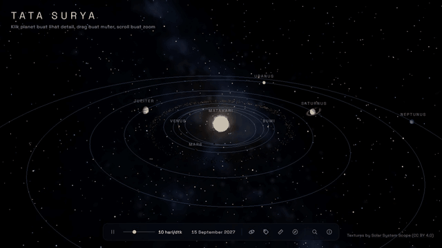
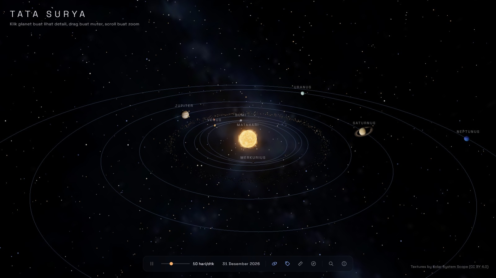
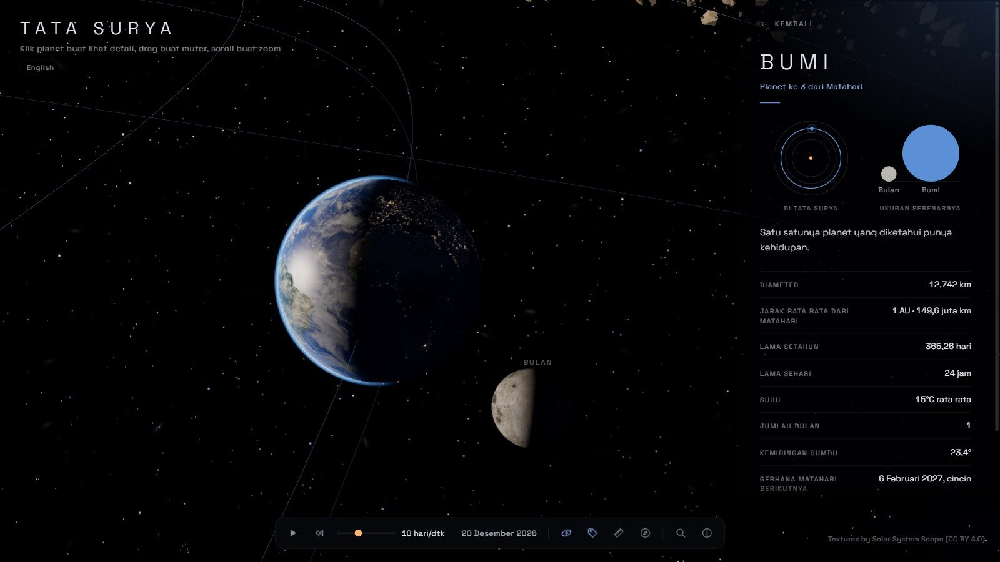
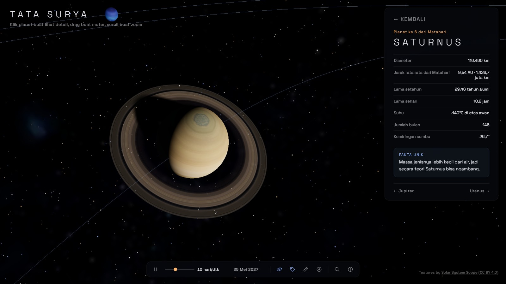
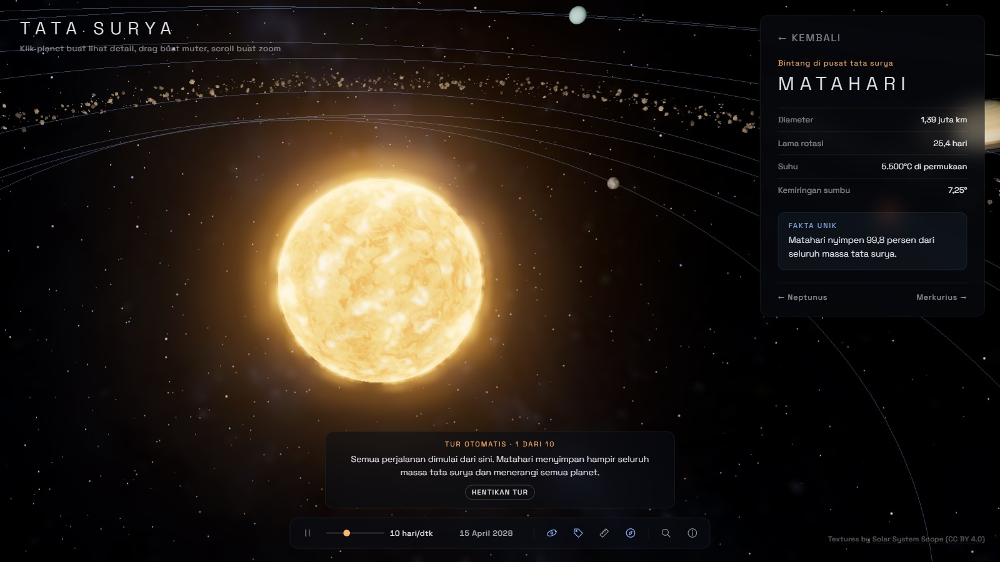
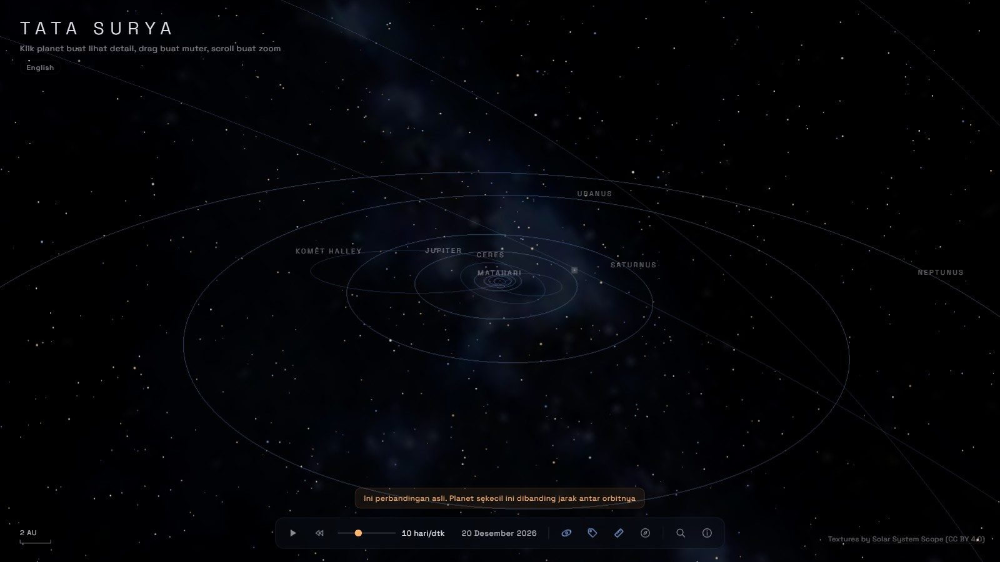
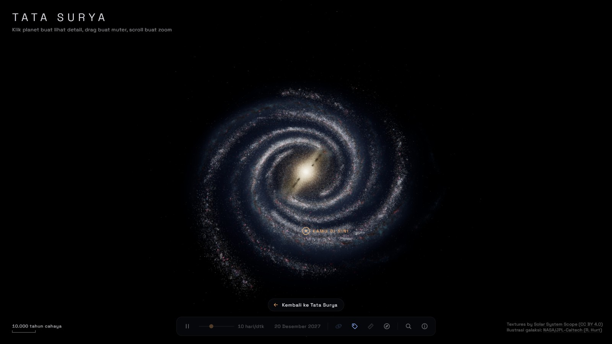
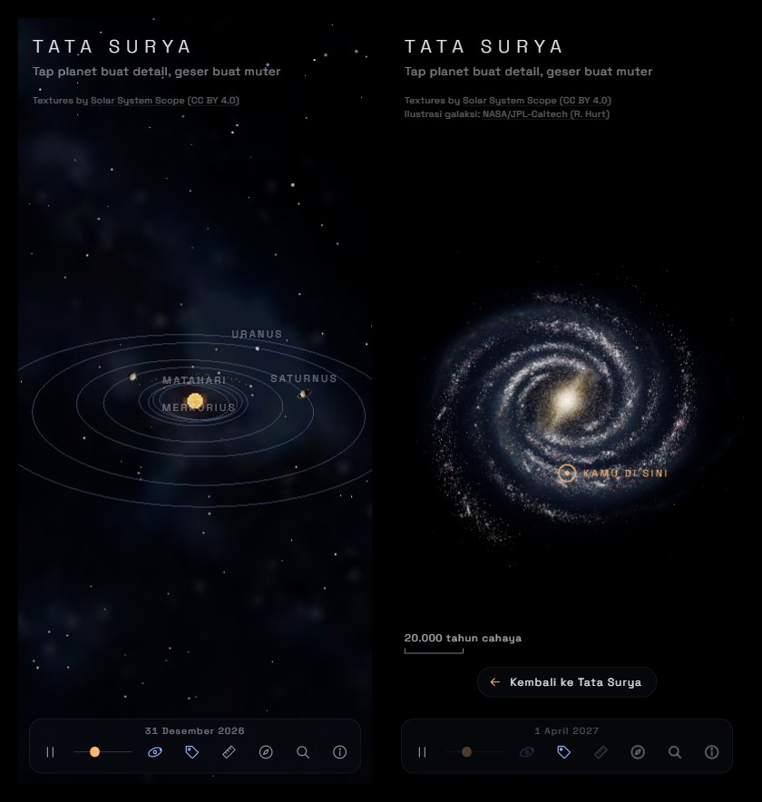

# Interactive Solar System

[](https://solarsystem-id.vercel.app)

A 3D solar system you can explore right in the browser. Click a planet to fly there, sit back for a guided tour, switch to true scale and see how tiny the planets are compared to the distances between their orbits, or keep zooming out past the nearest stars and the whole Milky Way until Andromeda comes into view.

Built with Three.js, GSAP, and Vite, no UI framework.

### [▶ Live demo: solarsystem-id.vercel.app](https://solarsystem-id.vercel.app)

> The interface is in Indonesian (Bahasa Indonesia).

## Features

- **Cinematic visuals.** Sun from a plasma shader with bloom. Three-layer Earth with day and night city lights, surface relief, sun glint on the oceans, clouds, and atmosphere. Saturn, Uranus, and Neptune have rings that receive the planet's shadow, a 2,000-rock asteroid belt renders in a single draw call, and the Milky Way sits in the background
- **Real planet positions.** Elliptical, inclined orbits from JPL orbital elements. Each planet's position is solved with Kepler's equation for the simulated date, so the layout on screen matches the actual sky today
- **Camera flights.** Click a planet, the Sun, or a moon and the camera flies there and locks onto the moving body without jitter, while you can still orbit around it freely
- **Info panel.** Diameter, distance, length of year and day, temperature, number of moons, axial tilt, and a fun fact. Everything comes from a single data file
- **Zoom out to the Milky Way and beyond.** Keep scrolling or pinching past Neptune and the view continues in one smooth zoom, from a few AU to about 3 million light years. The galaxy is built from up to 500,000 particles (bulge, bar, spiral arms, disk, halo, gas, and dust) generated in a Web Worker, with the Sun at its real position about 26,000 light years from the center and a "you are here" marker
- **Local Group.** The last stage shows the Milky Way with its neighbors: Andromeda, Triangulum, and the Large and Small Magellanic Clouds, built from particles in a second Web Worker and placed at their real sky positions and distances, with Andromeda's disk tilted as we actually see it. 25 real dwarf galaxies (M32, M110, NGC 6822, Leo I, and more) show as faint smudges, so the two clusters around the Milky Way and Andromeda are visible. Every large galaxy is clickable and opens an info panel
- **Nearest stars.** Between the solar system and the galaxy there is a stage with the 33 nearest and best-known stars (Alpha Centauri, Sirius, Vega, Arcturus, and more), colored by spectral class. Each one is clickable and opens an info panel
- **Scale bar and stage names.** A scale bar with round numbers that switches from AU to light years, a short title whenever you enter a new stage (solar system, nearest stars, Milky Way), and a "Back to the solar system" button that zooms you home
- **Guided tour.** From the Sun out to Neptune, then out to the whole galaxy and the Local Group, with a short narration at each stop. It stops on its own as soon as you take over the camera
- **True scale.** A 2.5 second transition from the "pretty" scale to real proportions (1 AU = 400 units) and back
- **Time controls.** Pause, 4 speed presets (1 day to 1 year per second), and a simulation date that starts today
- **Search.** Press `/` or `Ctrl+K`, type a planet, moon, nearby star, or galaxy name (English spellings and catalog names like M31 work too), press Enter to fly there. Typing "Milky Way" or "galaksi" zooms out to the whole galaxy, "Local Group" or "Grup Lokal" all the way out. There is one hidden object that shows up if you type its name
- **Dwarf planets and comets.** Ceres in the asteroid belt, Haumea (stretched into an egg shape by its 4 hour day, with its ring), Makemake, and Eris, each on its real orbit. Halley's Comet and Comet Encke grow a coma and two tails as they near the Sun: a straight blue ion tail and a curved dust tail, both always pointing away from the Sun. Encke reaches perihelion in February 2027, so its tail is already visible; speed up time to watch Halley return in 2061
- **16 moons.** The Moon, Phobos, Deimos, Jupiter's 4 Galilean moons, Enceladus, Rhea, and Titan around Saturn, Miranda, Titania, and Oberon around Uranus, and Triton around Neptune, all clickable. Moons of the outer planets orbit in their planet's equatorial plane, so Uranus's moons are tipped over with it and Triton orbits backwards
- **Mobile friendly.** Swipe-to-close bottom sheet, compact toolbar, and graphics quality that drops automatically on slower devices
- **Accessible.** Every button has a label and tooltip, and everything works from the keyboard

## Screenshots

| | |
|---|---|
|  |  |
|  |  |
|  |  |
|  | |

## Running locally

Requires Node.js 18 or newer.

```bash
npm install
npm run dev
```

Open the address printed in the terminal (usually http://localhost:5173).

Production build

```bash
npm run build     # output goes to dist/
npm run preview   # serve the build locally
```

## Controls

| Action | Mouse / touch | Keyboard |
|---|---|---|
| Select a body | Click / tap | |
| Orbit the camera | Drag / one finger | |
| Zoom (all the way out to the galaxy) | Scroll / pinch | |
| Pan | Right click + drag | |
| Back to overview | Click empty space, Back button, swipe the panel down (mobile) | `Esc` |
| Back to the solar system | "Back to the solar system" button (appears once you zoom out) | |
| Previous / next planet | Buttons under the info panel | `←` `→` |
| Pause / resume | Play button | `Space` |
| Time speed | Slider | `1` to `4` |
| Orbit lines / labels | Toolbar buttons | `O` / `L` |
| True scale | Toolbar button | `S` |
| Guided tour | Toolbar button | `T` |
| Search | Toolbar button | `/` or `Ctrl+K` |
| About | Toolbar button | `?` |
| Skip intro | Click anywhere | Any key |

## Technical notes

The parts most worth reading in the code

- **Jitter-free camera follow** ([cameraRig.js](src/controls/cameraRig.js)). While flying, the camera's destination is recomputed every frame from the planet's current position. Once it arrives, the camera and its target are moved by the planet's per-frame delta. The update order in the main loop is deliberate (planets, then camera, then `controls.update()`). Measured drift between camera and planet: 1e-14 over 120 frames
- **Earth's day and night** ([earth.frag](src/shaders/earth.frag)). One shader blends the day map and night map with a `smoothstep` across the terminator. Sun direction and normals are both in world space, so the terminator stays put when the camera rotates. Relief comes from a normal map (tangents are derived in the shader, no `computeTangents`), and a Blinn-Phong sun glint appears only on water via the specular map
- **Kepler orbits** ([kepler.js](src/utils/kepler.js)). J2000 orbital elements are rotated into the ecliptic plane and Kepler's equation is solved with Newton's method. In the pretty scale only the distance from the Sun is compressed while the direction is kept, so orbital inclination and perihelion direction stay correct
- **Two scale modes without new geometry** ([scaleMode.js](src/scene/scaleMode.js), [scale.js](src/utils/scale.js)). Geometry is created once, and the transition only changes scale and position using geometric interpolation (the two modes differ by up to 76x). The camera near plane is dynamic, because in true scale the camera can be just 0.1 units from Earth
- **Precise picking** ([picker.js](src/controls/picker.js)). Raycasts hit the real meshes first, then enlarged hit areas. Hit areas are at least 9 px on screen so a planet smaller than a pixel is still clickable, and they are only used when the body looks small
- **Overlap-free labels** ([labels.js](src/ui/labels.js)). Labels that collide on screen are hidden by priority, without reading DOM sizes every frame
- **One zoom from AU to light years** ([zoomLevels.js](src/galaxy/zoomLevels.js), [galaxyScene.js](src/galaxy/galaxyScene.js)). Zoom is tracked as `zoomLevel`, the base-10 log of the camera distance in AU. Past the solar system's zoom limit the camera stops moving and a virtual offset keeps increasing instead, so the solar camera returns to exactly where it was when you zoom back in. The galaxy lives in its own scene (1 unit = 100 light years) rendered underneath the solar system, which avoids floating-point precision trouble across 10 orders of magnitude. Stage names and the back button use hysteresis so they don't flicker at the boundaries
- **Galaxy particles off the main thread** ([galaxyWorker.js](src/workers/galaxyWorker.js), [galaxyParticles.js](src/galaxy/galaxyParticles.js)). Particles are generated only when you start zooming out, in a Web Worker, and handed back as transferable buffers (500,000 on desktop, 100,000 on mobile). Each component is warmed up on the GPU one per frame, shaders are precompiled one object per frame, and the NASA illustration underneath is decoded in a worker and uploaded in 512 px tiles. The result is no long tasks during the zoom on a 4x throttled mobile CPU
- **Performance.** FPS is sampled every second. If it stays under 40 for 3 seconds, the pixel ratio drops to 1 (bloom is also turned off on mobile). Rendering stops completely while the tab is hidden. Textures are WebP, 58 percent smaller than the original JPGs

## Textures

Textures by [Solar System Scope](https://www.solarsystemscope.com/textures/) (CC BY 4.0), stored in `public/textures/` as WebP. The galaxy illustration `milky_way_top.webp` comes from [NASA/JPL-Caltech (R. Hurt)](https://photojournal.jpl.nasa.gov/catalog/PIA10748). If it is missing, the galaxy is still drawn from particles alone.

The code keeps the original file names (for example `2k_mars.jpg`). The loader tries the `.webp` version first, then the original file, then a procedural texture. So this folder can hold WebP files, the original Solar System Scope files, or nothing at all (the project still runs).

To convert to WebP again, use [cwebp](https://developers.google.com/speed/webp/download)

```bash
cd public/textures
for f in *.jpg; do cwebp -q 85 "$f" -o "${f%.jpg}.webp"; done
cwebp -lossless 2k_saturn_ring_alpha.png -o 2k_saturn_ring_alpha.webp
cwebp -q 90 2k_earth_normal_map.png -o 2k_earth_normal_map.webp
cwebp -q 85 2k_earth_specular_map.png -o 2k_earth_specular_map.webp
```

Solar System Scope ships Earth's normal and specular maps as `.tif`, which browsers can't read, so convert them to `.png` first (with Pillow or GIMP, for example) before WebP.

Saturn's ring must be lossless because its transparency lives in the alpha channel. After converting, the original JPG / PNG files can be moved out of `public/` so they don't end up in the build. In this project they live in `textures-extra/original/` (git-ignored).

## Deployment

The live version is hosted on Vercel (Vite preset, no extra configuration). To deploy manually from the project folder

```bash
vercel deploy --prod
```

[.vercelignore](.vercelignore) keeps folders the build doesn't need (`textures-extra/`, `docs/`) from being uploaded.

All asset paths are relative to Vite's `BASE_URL`, so the app also works from a subfolder (GitHub Pages, for example). If the deployment address changes, update `og:url` and `og:image` in [index.html](index.html), since most social networks can't resolve relative paths.

## Project structure

```
src/
├── main.js              renderer, camera, bloom, main loop, wires all modules together
├── style.css
├── data/planets.js      planet, moon, and tour narration data (single source for all content)
├── data/nearbyStars.js  nearby star data (position, distance, spectral class, fun fact)
├── data/localGroup.js   Local Group galaxies and dwarf galaxies (sky position, distance, disk tilt, shape)
├── controls/
│   ├── picker.js        click / hover via raycasting, tells clicks apart from drags
│   ├── cameraRig.js     intro, camera flights, following the focused body
│   └── tour.js          guided tour (GSAP timeline)
├── ui/
│   ├── loader.js        loading screen (hooked to the LoadingManager)
│   ├── toolbar.js       play / pause, speed, date, display toggles
│   ├── labels.js        name labels above bodies (CSS2DRenderer) with overlap hiding
│   ├── infoPanel.js     info panel (side panel on desktop, bottom sheet on mobile)
│   ├── search.js        search (ARIA combobox)
│   ├── scaleBar.js      scale bar (AU, then light years)
│   ├── stageName.js     stage title when the zoom enters a new stage
│   └── zoomBack.js      "Back to the solar system" button
├── galaxy/
│   ├── zoomLevels.js    zoomLevel, stage boundaries, unit conversions
│   ├── galaxyScene.js   galaxy scene drawn under the solar system, framing per zoomLevel
│   ├── galaxyParticles.js  galaxy particles (from the worker), warm-up, local fade
│   ├── galaxyShaders.js particle shaders
│   ├── galaxyTexture.js NASA/JPL-Caltech illustration layer, uploaded tile by tile
│   ├── nearbyStars.js   clickable nearby stars
│   ├── localGroup.js    Local Group galaxies (particles from the worker, glow, labels, clicks)
│   └── youAreHere.js    "you are here" marker at the Sun
├── workers/
│   ├── galaxyWorker.js  generates the galaxy particles
│   ├── localGroupWorker.js  generates the Local Group galaxy particles
│   ├── particleKit.js   seeded RNG and particle helpers shared by both workers
│   └── imageWorker.js   decodes and tiles the galaxy illustration
├── scene/
│   ├── bodies.js        registry of selectable bodies, shared by all interaction modules
│   ├── scaleMode.js     transition between pretty and true scale
│   ├── sun.js           the Sun (plasma shader, glow, light)
│   ├── planets.js       planets, dwarf planets, and comets, elliptical orbits, rotation, axial tilt
│   ├── earth.js         three-layer Earth (day and night, relief, ocean glint, clouds, atmosphere)
│   ├── moons.js         moons orbiting their parent planets
│   ├── planetRing.js    rings of Saturn, Uranus, Neptune, and Haumea (radial UVs, planet shadow)
│   ├── comet.js         comet nucleus, coma, ion tail, and dust tail (particles placed in the vertex shader)
│   ├── asteroidBelt.js  asteroid belt (InstancedMesh, 1 draw call)
│   ├── orbits.js        elliptical orbit lines (buffer rewritten on scale change)
│   ├── stars.js         twinkling stars
│   └── milkyWay.js      Milky Way background
├── shaders/             Earth and atmosphere shaders (imported with ?raw)
└── utils/
    ├── scale.js         formulas for both scale modes
    ├── kepler.js        planet positions from orbital elements (Kepler's equation)
    ├── sky.js           sky coordinates (RA, Dec) to galaxy scene coordinates, galaxy disk orientation
    ├── time.js          simulation date and days since J2000
    ├── loader.js        shared LoadingManager, WebP first then fallbacks
    ├── performance.js   FPS monitoring and automatic quality drop
    ├── device.js        mobile detection
    ├── noise.js         noise for procedural textures
    └── planetTexture.js procedural textures (fallback when texture files are missing)
```

## Credits

- Textures by [Solar System Scope](https://www.solarsystemscope.com/textures/), licensed [CC BY 4.0](https://creativecommons.org/licenses/by/4.0/)
- Milky Way illustration (top view, the faint light layer under the galaxy particles) by [NASA/JPL-Caltech (R. Hurt)](https://photojournal.jpl.nasa.gov/catalog/PIA10748). The credit is shown in the app whenever the illustration is visible
- Planet data from the [NASA Planetary Fact Sheet](https://nssdc.gsfc.nasa.gov/planetary/factsheet/)
- Orbital elements from [JPL, Approximate Positions of the Planets](https://ssd.jpl.nasa.gov/planets/approx_pos.html)
- Font: [Space Grotesk](https://fonts.google.com/specimen/Space+Grotesk)
