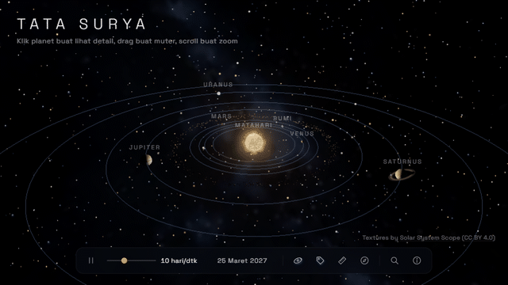
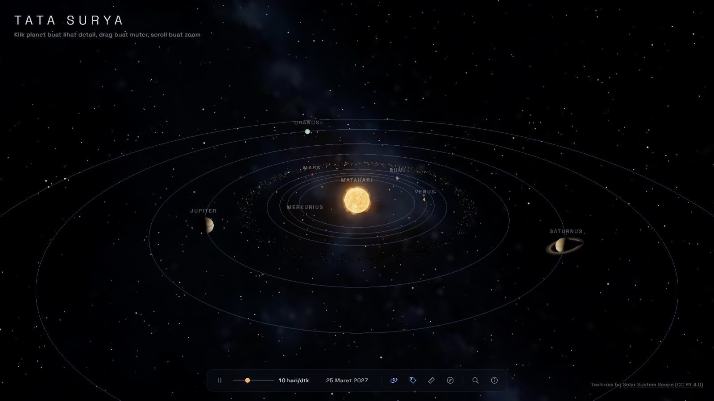
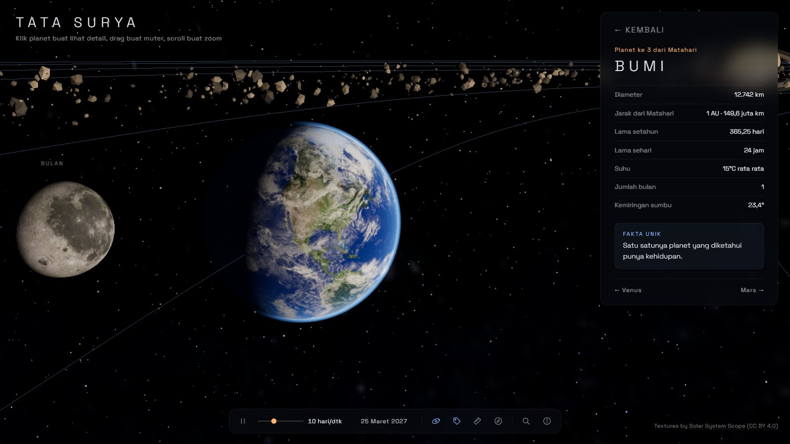
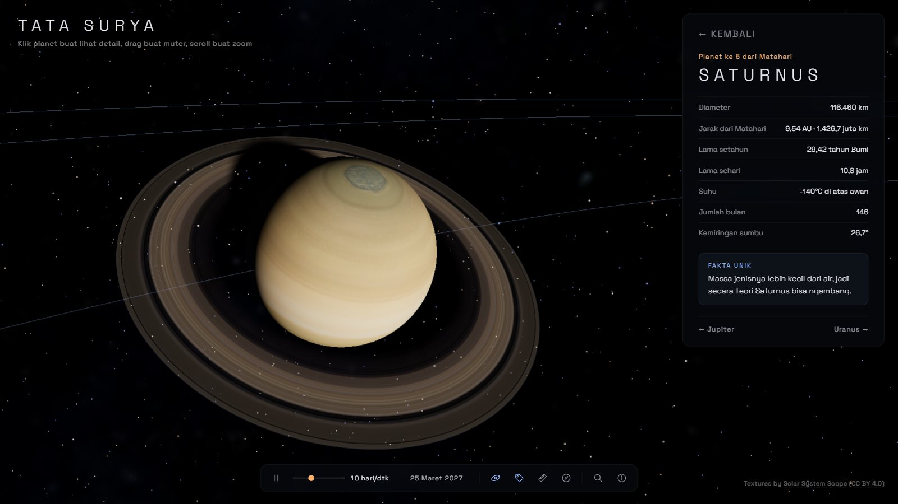
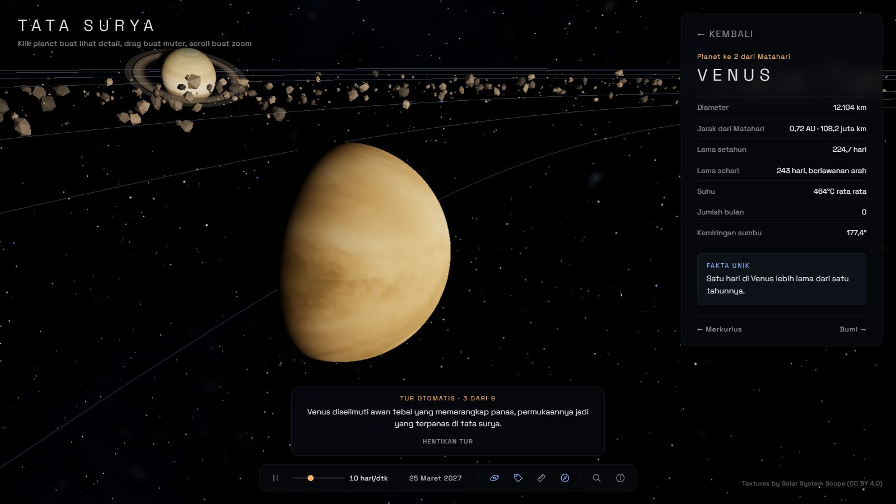
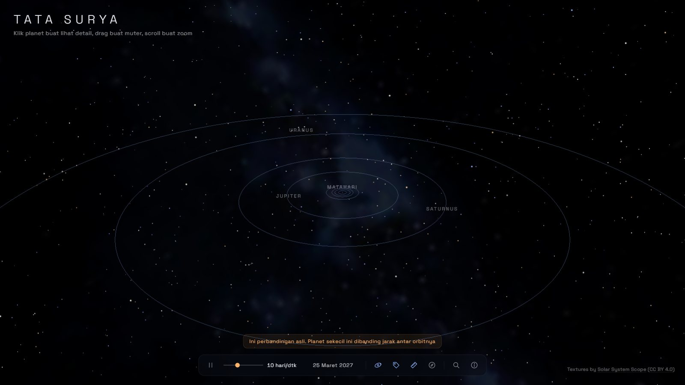
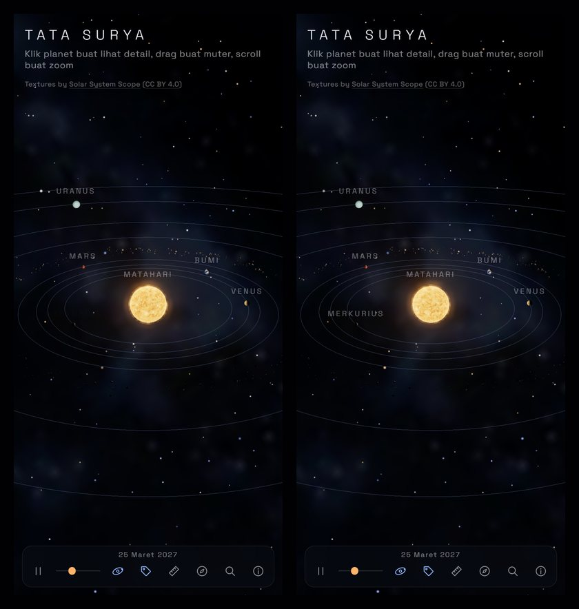

# Interactive Solar System

A 3D solar system you can explore right in the browser. Click a planet to fly there, sit back for a guided tour, or switch to true scale and see how tiny the planets are compared to the distances between their orbits.

Built with Three.js, GSAP, and Vite, no UI framework.

### [▶ Live demo: solarsystem-id.vercel.app](https://solarsystem-id.vercel.app)

> The interface is in Indonesian (Bahasa Indonesia).

[](https://solarsystem-id.vercel.app)

## Features

- **Cinematic visuals.** Sun from a plasma shader with bloom. Three-layer Earth with day and night city lights, surface relief, sun glint on the oceans, clouds, and atmosphere. Saturn's rings receive the planet's shadow, a 2,000-rock asteroid belt renders in a single draw call, and the Milky Way sits in the background
- **Real planet positions.** Elliptical, inclined orbits from JPL orbital elements. Each planet's position is solved with Kepler's equation for the simulated date, so the layout on screen matches the actual sky today
- **Camera flights.** Click a planet, the Sun, or a moon and the camera flies there and locks onto the moving body without jitter, while you can still orbit around it freely
- **Info panel.** Diameter, distance, length of year and day, temperature, number of moons, axial tilt, and a fun fact. Everything comes from a single data file
- **Guided tour.** From the Sun out to Neptune with a short narration at each stop. It stops on its own as soon as you take over the camera
- **True scale.** A 2.5 second transition from the "pretty" scale to real proportions (1 AU = 400 units) and back
- **Time controls.** Pause, 4 speed presets (1 day to 1 year per second), and a simulation date that starts today
- **Search.** Press `/` or `Ctrl+K`, type a planet or moon name (English spellings work too), press Enter to fly there. There is one hidden object that shows up if you type its name
- **9 moons.** The Moon, Phobos, Deimos, and Jupiter's 4 Galilean moons, all clickable
- **Mobile friendly.** Swipe-to-close bottom sheet, compact toolbar, and graphics quality that drops automatically on slower devices
- **Accessible.** Every button has a label and tooltip, and everything works from the keyboard

## Screenshots

| | |
|---|---|
|  |  |
|  |  |
|  |  |

## Running locally

Requires Node.js 18 or newer.

```bash
npm install
npm run dev
```

Open the address printed in the terminal (usually http://localhost:5173).

Production build

```bash
npm run build     # output goes to dist/
npm run preview   # serve the build locally
```

## Controls

| Action | Mouse / touch | Keyboard |
|---|---|---|
| Select a body | Click / tap | |
| Orbit the camera | Drag / one finger | |
| Zoom | Scroll / pinch | |
| Pan | Right click + drag | |
| Back to overview | Click empty space, Back button, swipe the panel down (mobile) | `Esc` |
| Previous / next planet | Buttons under the info panel | `←` `→` |
| Pause / resume | Play button | `Space` |
| Time speed | Slider | `1` to `4` |
| Orbit lines / labels | Toolbar buttons | `O` / `L` |
| True scale | Toolbar button | `S` |
| Guided tour | Toolbar button | `T` |
| Search | Toolbar button | `/` or `Ctrl+K` |
| About | Toolbar button | `?` |
| Skip intro | Click anywhere | Any key |

## Technical notes

The parts most worth reading in the code

- **Jitter-free camera follow** ([cameraRig.js](src/controls/cameraRig.js)). While flying, the camera's destination is recomputed every frame from the planet's current position. Once it arrives, the camera and its target are moved by the planet's per-frame delta. The update order in the main loop is deliberate (planets, then camera, then `controls.update()`). Measured drift between camera and planet: 1e-14 over 120 frames
- **Earth's day and night** ([earth.frag](src/shaders/earth.frag)). One shader blends the day map and night map with a `smoothstep` across the terminator. Sun direction and normals are both in world space, so the terminator stays put when the camera rotates. Relief comes from a normal map (tangents are derived in the shader, no `computeTangents`), and a Blinn-Phong sun glint appears only on water via the specular map
- **Kepler orbits** ([kepler.js](src/utils/kepler.js)). J2000 orbital elements are rotated into the ecliptic plane and Kepler's equation is solved with Newton's method. In the pretty scale only the distance from the Sun is compressed while the direction is kept, so orbital inclination and perihelion direction stay correct
- **Two scale modes without new geometry** ([scaleMode.js](src/scene/scaleMode.js), [scale.js](src/utils/scale.js)). Geometry is created once, and the transition only changes scale and position using geometric interpolation (the two modes differ by up to 76x). The camera near plane is dynamic, because in true scale the camera can be just 0.1 units from Earth
- **Precise picking** ([picker.js](src/controls/picker.js)). Raycasts hit the real meshes first, then enlarged hit areas. Hit areas are at least 9 px on screen so a planet smaller than a pixel is still clickable, and they are only used when the body looks small
- **Overlap-free labels** ([labels.js](src/ui/labels.js)). Labels that collide on screen are hidden by priority, without reading DOM sizes every frame
- **Performance.** FPS is sampled every second. If it stays under 40 for 3 seconds, the pixel ratio drops to 1 (bloom is also turned off on mobile). Rendering stops completely while the tab is hidden. Textures are WebP, 58 percent smaller than the original JPGs

Every technical decision and the reasoning behind it is logged in the decision log (Catatan Keputusan) in [PRD.md](PRD.md), written in Indonesian.

## Textures

Textures by [Solar System Scope](https://www.solarsystemscope.com/textures/) (CC BY 4.0), stored in `public/textures/` as WebP.

The code keeps the original file names (for example `2k_mars.jpg`). The loader tries the `.webp` version first, then the original file, then a procedural texture. So this folder can hold WebP files, the original Solar System Scope files, or nothing at all (the project still runs).

To convert to WebP again, use [cwebp](https://developers.google.com/speed/webp/download)

```bash
cd public/textures
for f in *.jpg; do cwebp -q 85 "$f" -o "${f%.jpg}.webp"; done
cwebp -lossless 2k_saturn_ring_alpha.png -o 2k_saturn_ring_alpha.webp
cwebp -q 90 2k_earth_normal_map.png -o 2k_earth_normal_map.webp
cwebp -q 85 2k_earth_specular_map.png -o 2k_earth_specular_map.webp
```

Solar System Scope ships Earth's normal and specular maps as `.tif`, which browsers can't read, so convert them to `.png` first (with Pillow or GIMP, for example) before WebP.

Saturn's ring must be lossless because its transparency lives in the alpha channel. After converting, the original JPG / PNG files can be moved out of `public/` so they don't end up in the build. In this project they live in `textures-extra/original/` (git-ignored).

## Deployment

The live version is hosted on Vercel (Vite preset, no extra configuration). To deploy manually from the project folder

```bash
vercel deploy --prod
```

[.vercelignore](.vercelignore) keeps folders the build doesn't need (`textures-extra/`, `docs/`) from being uploaded.

All asset paths are relative to Vite's `BASE_URL`, so the app also works from a subfolder (GitHub Pages, for example). If the deployment address changes, update `og:url` and `og:image` in [index.html](index.html), since most social networks can't resolve relative paths.

## Project structure

```
src/
├── main.js              renderer, camera, bloom, main loop, wires all modules together
├── style.css
├── data/planets.js      planet, moon, and tour narration data (single source for all content)
├── controls/
│   ├── picker.js        click / hover via raycasting, tells clicks apart from drags
│   ├── cameraRig.js     intro, camera flights, following the focused body
│   └── tour.js          guided tour (GSAP timeline)
├── ui/
│   ├── loader.js        loading screen (hooked to the LoadingManager)
│   ├── toolbar.js       play / pause, speed, date, display toggles
│   ├── labels.js        name labels above bodies (CSS2DRenderer) with overlap hiding
│   ├── infoPanel.js     info panel (side panel on desktop, bottom sheet on mobile)
│   └── search.js        search (ARIA combobox)
├── scene/
│   ├── bodies.js        registry of selectable bodies, shared by all interaction modules
│   ├── scaleMode.js     transition between pretty and true scale
│   ├── sun.js           the Sun (plasma shader, glow, light)
│   ├── planets.js       planets and dwarf planets, elliptical orbits, rotation, axial tilt
│   ├── earth.js         three-layer Earth (day and night, relief, ocean glint, clouds, atmosphere)
│   ├── moons.js         moons orbiting their parent planets
│   ├── saturnRing.js    ring with radial UVs and the planet's shadow
│   ├── asteroidBelt.js  asteroid belt (InstancedMesh, 1 draw call)
│   ├── orbits.js        elliptical orbit lines (buffer rewritten on scale change)
│   ├── stars.js         twinkling stars
│   └── milkyWay.js      Milky Way background
├── shaders/             Earth and atmosphere shaders (imported with ?raw)
└── utils/
    ├── scale.js         formulas for both scale modes
    ├── kepler.js        planet positions from orbital elements (Kepler's equation)
    ├── time.js          simulation date and days since J2000
    ├── loader.js        shared LoadingManager, WebP first then fallbacks
    ├── performance.js   FPS monitoring and automatic quality drop
    ├── device.js        mobile detection
    ├── noise.js         noise for procedural textures
    └── planetTexture.js procedural textures (fallback when texture files are missing)
```

## Credits

- Textures by [Solar System Scope](https://www.solarsystemscope.com/textures/), licensed [CC BY 4.0](https://creativecommons.org/licenses/by/4.0/)
- Planet data from the [NASA Planetary Fact Sheet](https://nssdc.gsfc.nasa.gov/planetary/factsheet/)
- Orbital elements from [JPL, Approximate Positions of the Planets](https://ssd.jpl.nasa.gov/planets/approx_pos.html)
- Font: [Space Grotesk](https://fonts.google.com/specimen/Space+Grotesk)
